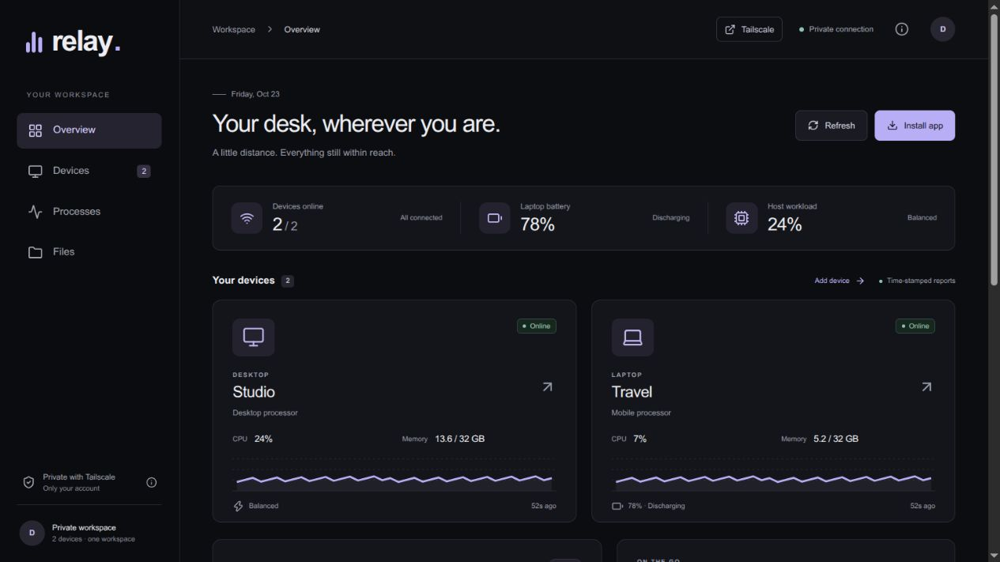
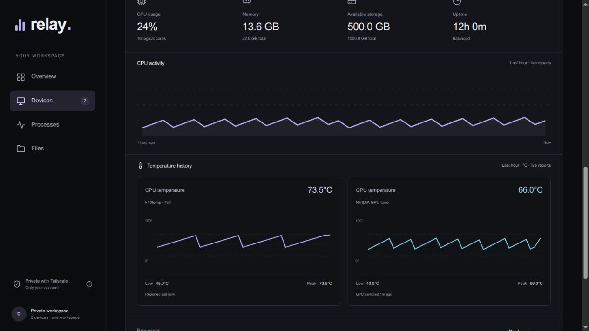
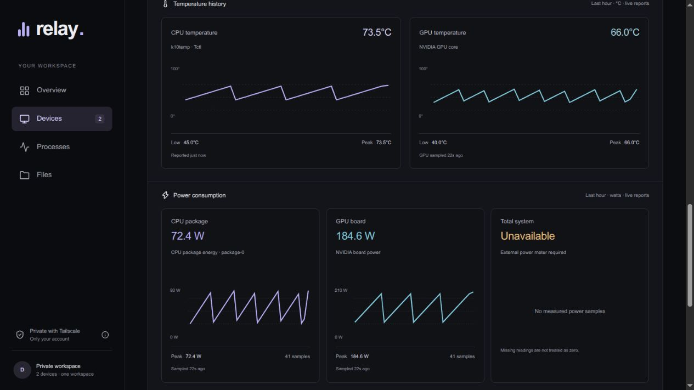

# Relay

A self-hosted, installable device dashboard built with MongoDB, Express, React and Node.js. Open one private website from a phone, tablet or computer to see your Linux machines, battery and GPU state, temperatures, measured power, running processes, and personal folders. Confirm lock, reboot and shutdown requests from the device detail view.

Relay is a reusable application. Device names, addresses, ownership and keys are created during installation and stored outside the source tree. No personal account or hardware details are required in the code.



*Preview with synthetic devices and readings.*



*Temperature view with synthetic training readings.*



*Power view with synthetic readings; whole-PC power remains unavailable without a meter.*

The interface uses a minimal charcoal theme with a lavender accent. The **Tailscale** button opens the network dashboard in a separate tab.

## What it does

- Reports device availability, CPU, memory, storage, uptime, network rates, power profile and battery capacity/condition.
- CPU and GPU temperatures on device cards and per-device history charts, including observed low/peak values for the recent hour. Intel package and AMD hwmon sensors are detected automatically, with the source label shown. AMD Tctl is displayed as reported; it is not relabeled as a die sensor.
- Optional NVIDIA monitoring on desktops follows the reporting interval (30 seconds by default). Laptop monitoring reads PCI power state without invoking NVIDIA tools; passive GPU temperatures are read only when that GPU is already active. A powered-down GPU has no current temperature reading.
- CPU package, GPU board and whole-device power charts with explicit measurement scope. Missing sensors stay unavailable; CPU and GPU watts are never presented as a summed system total.
- Device controls for locking the agent account’s desktop sessions, normal reboot and normal shutdown. A fresh one-use confirmation is required, including a typed device name for reboot/shutdown.
- Shows up to 250 processes per device, with search and CPU/memory sorting. Process names are collected; command arguments are excluded.
- Keeps 48 hours of metric history in MongoDB; process lists are overwritten by the latest report.
- Browses and downloads files through the host or Tailscale SSH. There are no upload, deletion, terminal or process-control endpoints.
- Installs as a PWA. Only the application shell is cached; readings, files and enrollment credentials are never stored in the service-worker cache.
- Adds Linux devices through the dashboard, generating a separate enrollment bundle for each device.

This release is a single-owner workspace for a private Tailscale network, rather than a public service with user registration. Different people can install separate workspaces with their own configuration.

## Requirements

Host: Linux with systemd, Node.js 22.12+, npm, Python 3, curl, Docker access for the regular account, and Tailscale. Use a supported current Node release. Allow adequate disk space for a MongoDB image, database and backups.

Agents: Linux, Python 3 and systemd. Tailscale must reach the host. Windows, macOS, Android and iOS can view the website; native telemetry agents for these platforms are not included.

For remote file browsing, enable Tailscale SSH on each agent machine and allow the host to access the specified regular Linux account. Interactive SSH check-mode reauthentication can interrupt unattended file browsing; use a carefully scoped policy appropriate to your network.

## Install a workspace

Run the following as your regular Docker-enabled user on the host. Do not run npm or configuration generation as root.

```sh
mkdir -p "$HOME/.local/share/relay/app"
cp -a . "$HOME/.local/share/relay/app/"
cd "$HOME/.local/share/relay/app"
npm ci
npm run build
python3 scripts/configure.py --name 'Home server' --kind server
python3 scripts/install-agent.py --config "$HOME/.config/relay/agent.json" --no-start
sudo bash scripts/install-server.sh
```

`configure.py` discovers your Tailscale login and host DNS name. You can supply `--owner YOUR_LOGIN --url https://HOST.TAILNET.ts.net` explicitly. Other options include `--port`, `--mongo-port`, `--name` and `--kind desktop|laptop|server`.

The default application port is 4310; MongoDB uses 27021. Both bind only to loopback. Configuration generation refuses to overwrite an existing workspace or an existing `relay-mongo` container. The installer refuses a conflicting Tailscale Serve root. Enable HTTPS for the tailnet if Tailscale prints an enablement link. It uses **Serve**, not Funnel: the workspace remains private to the tailnet and the configured login.

If a browser cannot resolve the private address while system DNS works, check whether a forced custom DNS-over-HTTPS provider bypasses Tailscale MagicDNS. Use the browser’s system/current-provider automatic mode for private DNS support. Keep Tailscale and HTTPS enabled.

The installer creates `relay-hub.service` and `relay-agent.service` as system services running under your regular account. They start at boot. MongoDB uses its own `relay-mongo-data` Docker volume, authenticated database user, 768 MB memory limit and bounded container logs. Metric retention is 48 hours, not a fixed storage-size quota; total use depends on device count and report interval.

Open the private HTTPS URL shown by the installer. On a phone, connect Tailscale first, open the URL in Chrome/your browser, and choose **Install app** or **Add to Home screen**. Browser support varies; the dashboard includes installation instructions. Live access requires the Linux host to be on and connected. Booting that host into another OS takes this installation offline.

## Add a device

Devices are enrolled explicitly. Joining Tailscale does not automatically register a device with Relay. A phone can install and view the PWA without an agent; this release does not collect phone battery or process telemetry. Linux laptops, desktops and servers can report through the supplied agent.

1. Choose **Add device** and supply a display name, type and report interval.
2. For file browsing, also supply its Tailscale hostname/IP and Linux username. SSH policy must permit the host to reach that account.
3. Download that device's agent bundle and extract it on the target Linux machine.
4. Run `python3 install-agent.py --config device.json` as the target regular user.

The bundle contains a private reporting key. Treat it as a credential and do not commit or publicly share it. Each key can report only for its assigned device; it does not grant dashboard or file access. The default user agent runs while the user session is active. Use an appropriate system service for machines that must report before login. Installing a second agent overwrites that Linux account's existing Relay agent configuration.

Agents report every 30 seconds by default; the browser refreshes visible data every 10 seconds. Brief delays are expected. Offline status is inferred from reports, rather than an independent reachability probe. Files require the source machine to be awake. The agent runs under the installing account, so it can see only processes and files accessible to that account.

## Power measurements and device controls

Update all three agent files together: `agent.py`, `relay_power.py`, and `relay_controls.py`. New enrollment ZIPs include them automatically. Remote controls use the same approved Tailscale SSH destination as file browsing. An ingestion key alone cannot issue actions.

On **each Linux device**, optionally install CPU power sampling and noninteractive reboot/shutdown permission:

```sh
sudo bash scripts/install-device-access.sh  # from a source checkout
# Or, from an extracted enrollment bundle:
sudo bash install-device-access.sh
```

This adds a small root-owned `relay-power.service` that reads package energy counters every two seconds and publishes only aggregate watts to `/run/relay-power/power.json`. The web server and reporting agent remain regular-user processes. The sampler has no network access, cannot change power limits, and does not make the raw energy counters world-readable. Duplicate RAPL interfaces and nested core domains are not added twice. Hardware support depends on the kernel and available energy domains; installing the sampler cannot create an unsupported sensor.

The installer also creates `/etc/polkit-1/rules.d/49-relay-device-controls.rules`. It permits the installing **account**, including its other programs, to request normal power-off/reboot, including when multiple sessions exist. It grants no general sudo, service management, root shell or inhibitor-bypass permission. The script does not lock, reboot or power off the device. If you need only monitoring, omit this installer; GPU and battery readings continue without it. To revoke the additional policy, remove this one rule. To remove the sampler, stop/disable `relay-power.service` and remove its own unit and `/usr/local/libexec/relay-power-sampler.py`.

Measurements:

- **CPU package:** recent two-second average from hardware energy-counter differences, sampled into the normal agent report. This is not whole-device power and may include integrated graphics or other package components depending on the hardware domain.
- **GPU board:** supported NVIDIA board-power telemetry at the configured reporting interval. Laptop discrete GPUs remain unpolled while powered down. Unsupported GPUs are unavailable.
- **Total system:** battery output while discharging with no external power supply online, or an explicitly configured external meter. Battery charging/input watts are not system-load watts. Desktop wall power requires a smart plug, UPS or other supported measurement source; it cannot be inferred accurately by adding CPU and GPU values.

For an external integration, set `system_power_file` in the private agent JSON to a local JSON file containing `{"watts": 210.5, "sampledAt": "2026-01-01T12:00:00+00:00", "source": "Wall meter"}`. Another adapter must update it; Relay does not include a plug/UPS adapter. Samples older than 90 seconds are ignored. Ensure the file actually measures the intended device rather than a shared power strip. Battery output and wall input remain separate graph scopes. No total energy/kWh or cost estimate is calculated from the sparse snapshots.

**Devices → device details → Device controls** offers Lock screen, Reboot and Power off. Controls require a recent report and a live capability check. Confirmation expires after 60 seconds and cannot be replayed. No GET request can trigger an action. Lock affects only local graphical sessions belonging to the agent’s account. Reboot/shutdown require typing the device name and acknowledging that training/notebooks will stop. Requests are scheduled three seconds later through the account’s systemd user manager and respect operating-system inhibitors; there is no forced shutdown option.

An active user manager is required for scheduling, and a graphical session for screen locking. User agents run while logged in by default; headless machines may need an administrator to configure appropriate user-manager persistence. Relay does not silently enable lingering. Actions can be refused by OS permissions or inhibitors; a submitted request is not proof that a screen locked or a machine powered off. Action status is polled after submission; if the device disconnects, check its state before retrying. Pending hub confirmations/status tracking do not survive a hub restart. Local action-status files are retained for seven days.

**Powering off the Relay host disconnects the whole dashboard.** It must be turned on separately before Relay is accessible again. Rebooting it also interrupts the hub until its services recover. Save work before either action. Device controls are intentionally excluded from automated live verification; unit/API tests use mocked command execution.

## Files and privacy

The default roots are Home and any existing Documents, Downloads and Desktop folders. To reduce access, edit `file_roots` in that device's private agent configuration. Hidden path components, parent traversal, symbolic links and common private-key names/extensions are blocked. This filtering is **not a universal secret detector**: an ordinary visible file may contain sensitive information. Expose only directories you intend the workspace owner to access. Whole-system and root filesystem browsing are not supported.

The app trusts the identity header injected by Tailscale Serve and checks it against `allowedLogins`. Keep the application bound to loopback and do not publish its raw port through another proxy. This is a private-host design; it does not defend against an untrusted local user able to connect directly to loopback and forge headers. Do not enable `HUB_LOCAL_PREVIEW` on a deployed service. The database and host configuration contain private data; protect backups accordingly.

Runtime files are under `~/.config/relay/` with private permissions. Source distributions exclude this directory. `hub.json` contains allowed logins, device registrations and per-device reporting keys. `agent.json` contains that machine's key and file roots. `server.env` and `mongo.env` contain database credentials. Never put them in a public repository.

## Operation and updates

```sh
systemctl status relay-hub relay-agent
journalctl -u relay-hub -n 50 --no-pager
systemctl --user status relay-agent  # user-installed remote agent
tailscale serve status
```

To update, back up the configuration and MongoDB data, copy new source into the installed app directory, run `npm ci && npm run build`, and restart the service (`sudo systemctl restart relay-hub`). The owning account can also send SIGHUP to its Node process: `pkill -HUP -u "$(id -u)" -f '/relay/app/server/index.js$'`; systemd restarts it after the configured 15-second delay. Update all three agent files on agent machines together when agent changes are needed. Rerun the optional device-access installer when its root-owned sampler or policy changes.

Back up `~/.config/relay/` and the `relay-mongo-data` volume consistently (stop Relay and MongoDB for a filesystem-level volume copy, or use authenticated MongoDB backup tools). The source archive does not contain the live database. Changing a reporting key requires updating both the host registration and the device configuration. To revoke access, stop the agent and remove its registration from `hub.json`, then restart the hub. Old history expires according to its TTL; removing registration does not instantly purge existing database records.

To remove Relay, stop/disable its services and remove only its unit files, app/config directory and its own Tailscale Serve handler. Keep configuration and the MongoDB volume until you have verified your backup. Never remove unrelated Docker containers, volumes or Serve routes.

## Development and verification

```sh
npm ci
npm test
npm run build
```

Temperature graphs preserve missing readings and reporting gaps. Metric history is retained for approximately 48 hours; charts display the recent hour. CPU readings from before the sensor update may be unavailable; no values are invented or backfilled. There are no universal danger thresholds or automatic throttling controls.

Tests cover power conversion/rollover, scope separation, stale meters, battery/AC handling, one-use action confirmation and expiry, mocked scheduling and inhibitor failures, Intel/AMD sensor selection, sleeping-GPU safety, missing temperature data, owner authentication, per-device ingestion keys, enrollment isolation, request validation, stale/offline behavior, SSH destination validation, traversal, hidden files, symbolic links, special files and exact download bytes. API tests open loopback sockets.

For a local UI preview, configure a test workspace/database, load its environment, and run the server with `NODE_ENV=development HUB_LOCAL_PREVIEW=1` on loopback. This intentionally bypasses owner authentication for development; never expose it remotely. `npm run dev` serves Vite UI development with the API proxy pointing at port 4310. Set `HUB_API_URL=http://127.0.0.1:OTHER_PORT` when the development API uses a different port.
